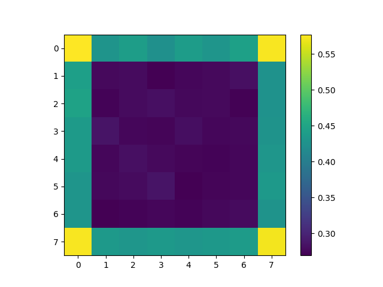
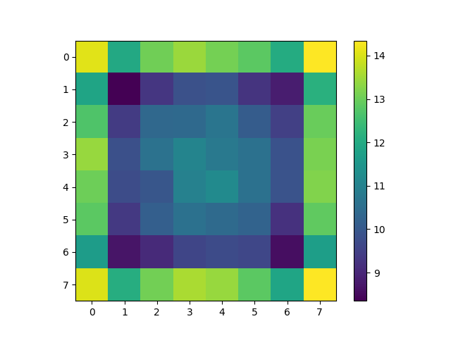
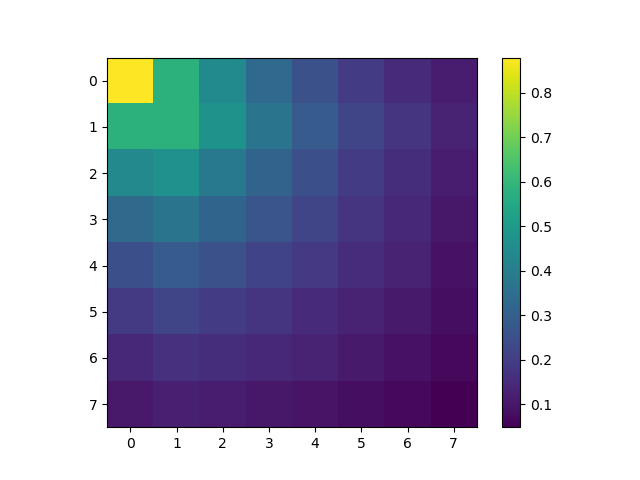
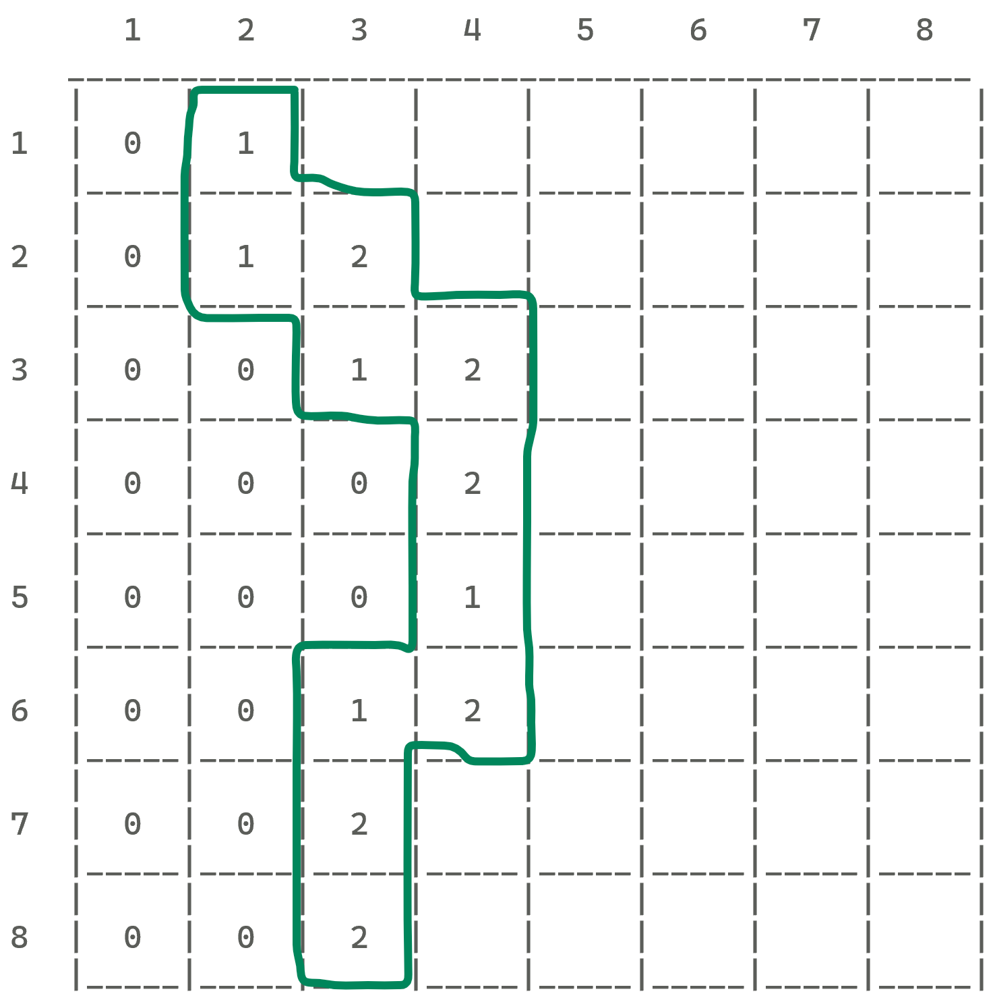
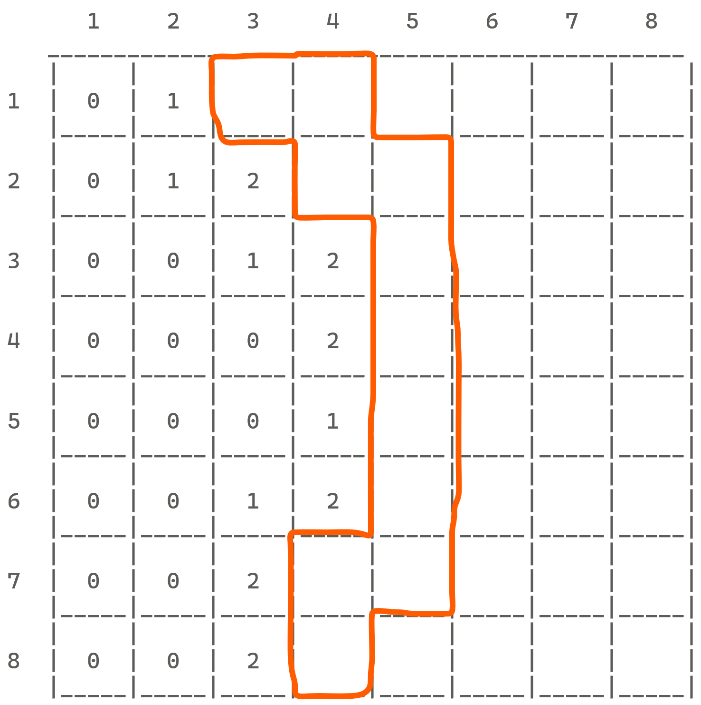
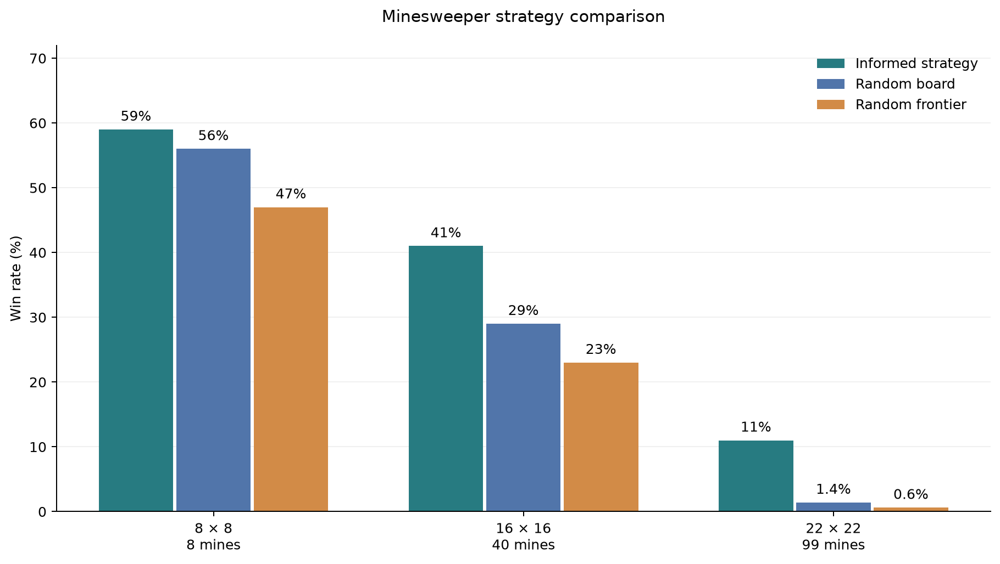

# Decision under uncertainty: Minesweeper

**How should a Minesweeper player choose a move when logical deductions run out?**

This project explores that question through local deductions, binary linear systems,
and Monte Carlo experiments.

## The investigation

1. **First click:** measure the opening produced by each starting position.
2. **Certain moves:** propagate local constraints to identify safe cells and mines.
3. **Uninformed guesses:** compare random hidden cells on the frontier with random
   hidden cells across the board.
4. **Informed guesses:** model frontier cells as binary variables, sample compatible
   assignments, and choose a cell with a low estimated mine frequency.

The project combines experiments with a mathematical model of compatible mine
arrangements. The implemented probability strategy uses sampling; the exact
weighted model is explained in the [scientific report](docs/scientific-summary.md).

## First-click experiments

In Minesweeper terminology, an **opening** is the area automatically revealed
when a zero-clue cell (a cell with no neighboring mines) is clicked. The reveal
spreads through connected zero-clue cells and includes the numbered cells along
their boundary. This is a game-specific term, not simply another name for the
first move.

For the measurements below, **opening size** counts all cells revealed by the
initial click: 0 if it hits a mine, 1 if it reveals only a numbered cell, and more
than 1 when it triggers an opening.

The saved heatmaps show why the starting position matters on an 8 × 8 board with
8 mines. These are original project outputs, not new simulations.

| Probability of an opening | Mean opening size |
| --- | --- |
|  |  |

Corners produce larger openings on average in these experiments. The left color
scale gives the probability of revealing more than one cell; the right scale
counts revealed cells. Mine hits contribute zero to the opening size.



The third heatmap records how often each cell was revealed after a first click in
the upper-left corner. See the [figure guide](docs/figures/README.md) for details.

## From clues to decisions

### Boundary and frontier

The **boundary** contains revealed numbered cells next to hidden cells. The
**frontier** contains hidden, unflagged cells next to revealed numbered cells.
Boundary clues supply constraints; frontier cells are the unknowns.

| Revealed boundary | Hidden frontier |
| --- | --- |
|  |  |

### Certain moves

If a clue's adjacent mines have all been flagged, its other hidden neighbors are
safe. If its remaining mine count equals its number of hidden neighbors, those
neighbors are all mines. The solver repeats these rules until no status changes.

### Decisions under uncertainty

When local deductions run out, the project compares three approaches:

- **Random frontier:** choose a random hidden frontier cell.
- **Random board:** choose a random hidden, unflagged cell anywhere on the board.
- **Informed:** use the constraints to estimate mine frequencies and choose a
  frontier cell with a low estimated frequency.

For the informed approach, each frontier cell is represented by a binary
variable: 1 means a mine and 0 means a safe cell. Each clue imposes an equation
requiring its neighboring variables to sum to the number of mines still to find.
The code samples binary solutions of this linear system and averages their mine
indicators to estimate how risky each frontier cell is.

The exact probability model additionally weights each frontier arrangement by
the number of ways its remaining mines can be placed outside the frontier.
The sampler does not implement this weighting or exhaustive enumeration, so its
frequencies are approximate; a sampled frequency of zero or one is not proof of
certainty. The [scientific report](docs/scientific-summary.md) defines all notation
and develops the equations and probability model step by step.

## Experimental results

| Square board | Mines | Informed strategy | Random board | Random frontier |
| --- | ---: | ---: | ---: | ---: |
| 8 × 8 | 8 | 59% | 56% | 47% |
| 16 × 16 | 40 | 41% | 29% | 23% |
| 22 × 22 | 99 | 11% | 1.4% | 0.6% |



The informed strategy achieves the highest win rate in all three configurations.
Random selection across the board also outperforms selection restricted to the
frontier. This motivates informed guesses, while showing that a nearby constrained
cell is not always a better choice than a hidden cell elsewhere.

These are the project's experimental results. New simulation runs produce their
own estimates. Experiment conventions and reproducibility details are documented
in the [implementation notes](docs/implementation-notes.md).

First-click opening size and whole-game success are distinct measurements: the
strategy experiments use a random initial cell and allow a first-click mine hit.

## Run an experiment

Use Python 3.10 or later. From the repository root:

```bash
python -m venv .venv
# Windows PowerShell:
.venv\Scripts\Activate.ps1
# macOS / Linux:
# source .venv/bin/activate
python -m pip install -r requirements.txt

python simulate.py --strategy board --size 8 --mines 8 --trials 1000 --seed 42
python simulate.py --strategy frontier --trials 1000 --seed 42
python simulate.py --strategy deduction --trials 1000 --seed 42
python simulate.py --strategy informed --trials 100 --seed 42 --output results/informed.json
```

The `deduction` baseline permits the initial random move and stops when the local
rules cannot advance. The `informed` strategy uses 1,000 sampling attempts per
system by default and can be slow on larger boards. **The first click can hit a
mine** in these experiments.

For first-click heatmaps:

```python
from minesweeper import opening_plots

opening_plots.plot_mean_opening(8, 1000)
opening_plots.plot_opening_probability(8, 1000)
opening_plots.plot_reveal_probability(8, 1000, 0, 0)
```

These plotting functions use the default 8 × 8 / 8-mine configuration in
`minesweeper.openings`. See the implementation notes before changing board sizes.

## Repository guide

```text
minesweeper/
    deductions.py          Local constraint propagation
    deduction_strategy.py  Deduction-only baseline
    random_strategy.py     Random frontier and random board strategies
    linear_system.py       Binary solution sampler
    informed_strategy.py   Strategy using the sampler
    openings.py            First-click simulation primitives
    opening_plots.py       First-click heatmaps
data/
    reported-win-rates.csv  Project strategy-comparison results
scripts/
    plot_reported_results.py  Regenerate the comparison chart
docs/
    figures/               Opening heatmaps, board diagrams, and figure guide
    scientific-summary.md  Detailed scientific report and notation
    implementation-notes.md  Limitations and refactoring decisions
    references.md          Research sources and code provenance
simulate.py                Explicit experiment entry point
tests/                     Focused regression and mathematical checks
```

The README presents the research question, method, figures, and main results.
The [scientific report](docs/scientific-summary.md) develops the mathematical
reasoning with defined notation; the [implementation notes](docs/implementation-notes.md)
describe numerical limitations and experiment conventions.
